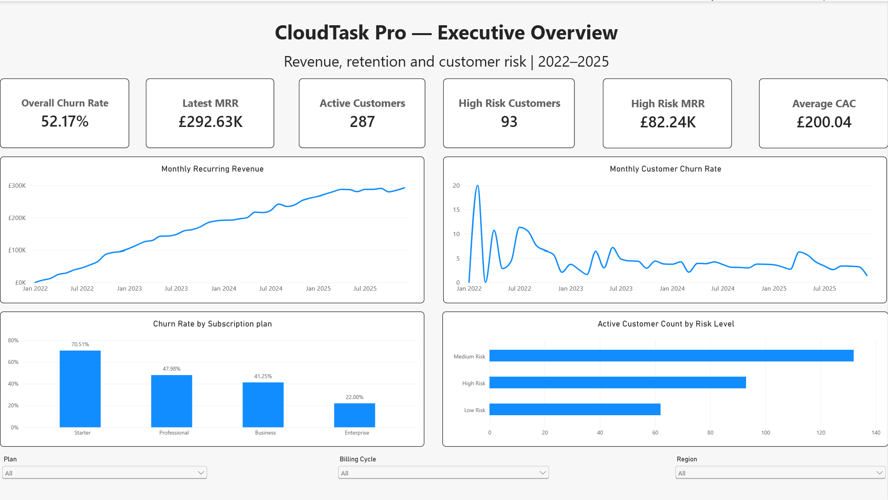
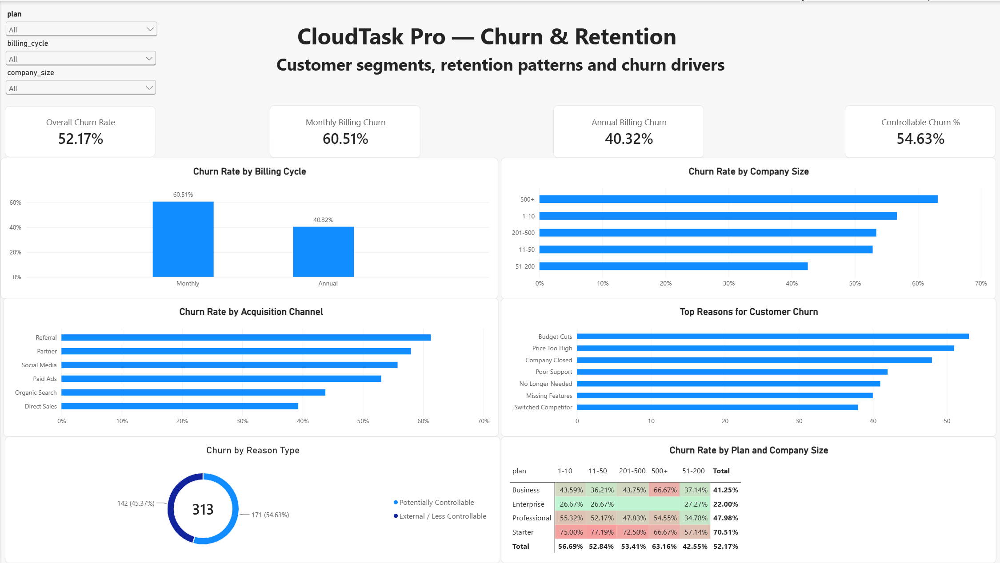
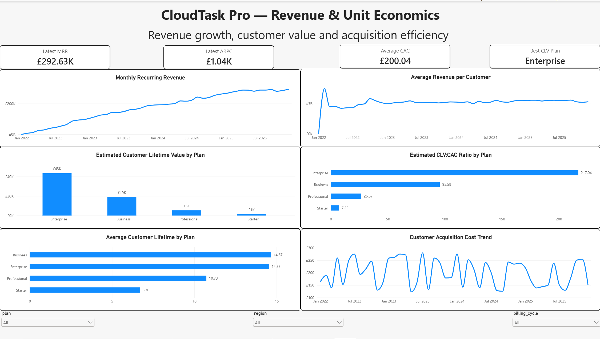
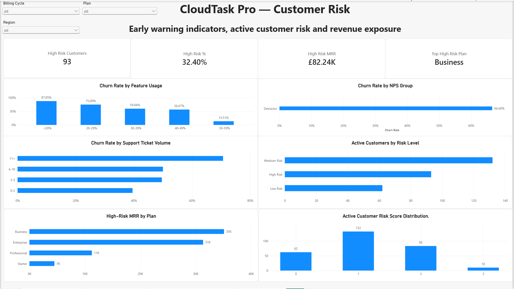

# CloudTask Pro — SaaS Revenue & Churn Analysis

End-to-end analysis of a B2B SaaS business across 2022–2025, covering churn, revenue
performance, unit economics and active-customer risk — built in SQL, validated in Excel,
and delivered as a four-page Power BI dashboard and an executive summary PDF.

## Dashboard Preview



> Four-page Power BI report covering executive KPIs, churn and retention,
> unit economics, and active-customer risk.

---

## Project Overview

CloudTask Pro is a B2B SaaS company represented by 600 customer records spanning 2022–2025, including 313 churned and 287 active customers.
The objective of this project was to analyze churn, revenue performance, customer
lifetime value, acquisition efficiency, and current customer risk.

The analysis moves from data validation through to a rule-based risk model that
classifies every active customer, so the output is an account list the business can
act on rather than a set of historical percentages.

## Headline Results

| Metric | Value |
|---|---|
| Customers analysed | 600 (313 churned / 287 active) |
| Period covered | Jan 2022 – Dec 2025 (48 months) |
| Latest MRR | £292.63K |
| All-time churn (2022–2025) | 52.17% |
| Monthly churn rate | 6.81% avg in 2022 → ~3.6% in 2024–2025 |
| Churn from potentially controllable causes | 54.63% (171 of 313) |
| Active customers flagged High Risk | 93 of 287 (32.40%) |
| MRR attached to High-Risk customers | £82.2K |
| Strongest unit economics | Enterprise (£42.9K estimated CLV) |

## Business Questions

| # | Question | Analysis |
|---|---|---|
| 1 | How has churn changed over time? | [02_churn_analysis.sql](sql/02_churn_analysis.sql) |
| 2 | Which plans and customer segments have the highest churn? | [02_churn_analysis.sql](sql/02_churn_analysis.sql) |
| 3 | Why are customers leaving? | [03_churn_reason.sql](sql/03_churn_reason.sql) |
| 4 | How has revenue grown, and where did it come under pressure? | [04_revenue_analysis.sql](sql/04_revenue_analysis.sql) |
| 5 | Which plans generate the strongest customer lifetime value? | [05_unit_economics.sql](sql/05_unit_economics.sql) |
| 6 | Which active customers are currently at risk? | [06_risk_analysis.sql](sql/06_risk_analysis.sql) |

## Tools

- **SQL (MySQL)** — data validation, cleaning and all analysis
- **Excel** — cross-validation of SQL results and executive summary
- **Power BI** — four-page interactive dashboard

## Repository Structure

```
cloudtask-pro-saas-analysis/
├── data/
│   ├── raw/                  # Source CSVs as received
│   │   ├── subscriptions.csv
│   │   └── monthly_revenue.csv
│   └── cleaned/              # Post-validation, used for Excel and Power BI
│       ├── subscriptions_cleaned.csv
│       └── monthly_revenue_clean.csv
├── sql/
│   ├── 01_data_quality.sql       # Table setup, cleaning, validation
│   ├── 02_churn_analysis.sql     # Overall and segment churn
│   ├── 03_churn_reason.sql       # Why customers leave
│   ├── 04_revenue_analysis.sql   # MRR growth and revenue pressure
│   ├── 05_unit_economics.sql     # Lifetime, CLV, CAC, CLV:CAC
│   └── 06_risk_analysis.sql      # Warning signals and risk scoring
├── excel/
│   ├── CloudTask_Pro_Analysis.xlsx          # Validation workbook
│   └── CloudTask_Pro_Executive_Summary.pdf  # One-page summary for stakeholders
├── powerbi/
│   └── CloudTask_Pro_Analysis.pbix
└── screenshots/              # Dashboard page exports
```

## Dataset

Two tables covering the full company history.

**`subscriptions.csv`** — 600 rows, one per customer, 17 fields.

| Field | Description |
|---|---|
| `customer_id` | Unique customer identifier (600 unique, no duplicates) |
| `plan` | Starter, Professional, Business, Enterprise |
| `billing_cycle` | Monthly or Annual |
| `industry` | Customer industry (10 categories) |
| `company_size` | 1-10, 11-50, 51-200, 201-500, 500+ employees |
| `seats` | Licensed seats |
| `monthly_revenue` | Monthly recurring revenue for the customer |
| `acquisition_channel` | Direct Sales, Organic Search, Paid Ads, Partner, Referral, Social Media |
| `region` | North America, Europe, Asia Pacific, Latin America |
| `signup_date` | Subscription start date |
| `churned` | Yes / No |
| `churn_date` | Date of churn (NULL for active customers) |
| `churn_reason` | Reason for churn (NULL for active customers) |
| `support_tickets_12mo` | Support tickets raised in the last 12 months |
| `nps_score` | Customer recommendation/NPS survey response score (0–10) |
| `feature_usage_pct` | Percentage of product features used |
| `upgraded` | Whether the customer upgraded plan |

**`monthly_revenue.csv`** — 48 rows, one per month (Jan 2022 – Dec 2025).

| Field | Description |
|---|---|
| `month` | Reporting month |
| `total_active_customers` | Active customers at month end |
| `new_customers` | Customers acquired in month |
| `churned_customers` | Customers lost in month |
| `monthly_churn_rate_pct` | Monthly customer churn rate |
| `total_mrr` | Total monthly recurring revenue |
| `avg_revenue_per_customer` | ARPC |
| `customer_acquisition_cost` | Blended CAC for the month |

## Analysis Workflow

1. **Data validation and cleaning** — row counts, duplicate checks, null profiling, date-type conversion, categorical consistency, range checks and signup/churn date logic
2. **Churn analysis** — overall, by plan, billing cycle, company size, acquisition channel and over time
3. **Churn reason analysis** — reasons by plan and company size, split into controllable vs external
4. **Revenue analysis** — MRR growth, ARPC movement, net customer change and periods of revenue pressure
5. **Unit economics** — average lifetime, CLV, CAC and CLV:CAC by plan
6. **Customer risk segmentation** — warning signals and a rule-based risk score for active customers
7. **Excel validation** — independent recalculation of SQL outputs
8. **Power BI dashboard** — four interactive pages with plan, billing cycle, company size and region slicers

## Key Findings

### Churn

All-time churn across 2022–2025 was **52.17%**, but the monthly churn rate improved
substantially over the period, falling from an average of 6.81% in 2022 to
approximately 3.6% across 2024–2025.

| Plan | Customers | Churn Rate |
|---|---|---|
| Starter | 217 | 70.51% |
| Professional | 173 | 47.98% |
| Business | 160 | 41.25% |
| Enterprise | 50 | 22.00% |

Churn falls consistently as plan tier rises. Billing cycle shows the same pattern:
**monthly-billed customers churned at 60.51% vs 40.32% for annual**.

By company size, the **500+ employee segment had the highest churn at 63.16%**, while
51–200 employee companies were the most stable at 42.55%. By acquisition channel,
**Referral produced the highest churn and Direct Sales the lowest**.

At segment level, Starter customers on monthly billing — particularly smaller
companies — represent one of the highest-risk customer groups.

### Why Customers Leave

Budget cuts, high pricing and company closures were the three most common churn
reasons. Splitting reasons by whether the business can influence them:

| Category | Customers | Share |
|---|---|---|
| Potentially controllable (price, support, missing features, competitor) | 171 | 54.63% |
| External / less controllable (budget cuts, company closed, no longer needed) | 142 | 45.37% |

**More than half of churn was associated with potentially addressable causes.**

Reasons differ sharply by segment. Starter and Professional customers most commonly
cited price or budget constraints; Business customers cited missing features; Enterprise
churn was tied to company closure or reduced need. Among the 500+ employee segment —
the group with the highest churn rate — **poor support** was a leading reason.

### Revenue

Average monthly MRR grew from approximately **£46K in 2022 to £283K in 2025**, with
latest MRR at £292.63K and latest ARPC at £1.04K.

- **March 2024** was the strongest month, contributing approximately **+£15.6K** estimated net MRR
- **April 2025** was the weakest at approximately **-£4.3K**
- **April and May 2025** both saw churned customers exceed new customers, producing negative net customer growth
- **October 2025** saw MRR fall 3.69% *despite* positive net customer growth, while ARPC fell 5.12%, suggesting a lower-value customer mix or other revenue-per-customer effects rather than customer losses alone.

Growth was strong overall, but elevated churn created identifiable periods of
short-term revenue pressure.

### Unit Economics

| Plan | Estimated CLV | Avg Lifetime (months) | Estimated CLV:CAC |
|---|---|---|---|
| Enterprise | £42.9K | 14.55 | 217.04 |
| Business | £18.5K | 14.67 | 95.58 |
| Professional | ~£5K | 10.73 | 26.67 |
| Starter | £1.34K | 6.70 | 7.22 |

Average CAC across the period was **£200.04**. Customer value increases substantially
with plan tier — Enterprise customers combine the highest CLV with the lowest churn
rate (22%), while Starter customers pair the weakest economics with the highest churn
rate (70.51%).

### Customer Risk

Three signals separated churned from retained customers:

| Signal | Pattern |
|---|---|
| Feature usage | Churn falls from 87.85% (<20% usage) to 13.51% (50–59% usage) |
| NPS | Detractors (NPS ≤ 6) churned at 66.60% |
| Support tickets | Customers with 11+ tickets in 12 months showed the highest churn of any ticket band |

Applying these as a rule-based score to the 287 active customers:

| Risk Level | Customers | Share of Active Base |
|---|---|---|
| High Risk | 93 | 32.40% |
| Medium Risk | 132 | 45.99% |
| Low Risk | 62 | 21.60% |

**£82.2K of current MRR sits with High-Risk customers**, concentrated in the higher
tiers — Business (£35K) and Enterprise (£31K) together account for the large majority,
ahead of Professional (£11K) and Starter (£5K).

## Risk Model

Each active customer receives one point for every warning signal present:

- Feature usage below 50%
- NPS score ≤ 6
- 11+ support tickets in the previous 12 months

| Score | Risk Level |
|---|---|
| 0 | Low Risk |
| 1 | Medium Risk |
| 2–3 | High Risk |

The model is intentionally simple and transparent so that the account list it produces
can be handed directly to customer success without further interpretation.

## Dashboard

Four interactive Power BI pages, filterable by plan, billing cycle, company size and region.
Source file: [CloudTask_Pro_Analysis.pbix](powerbi/CloudTask_Pro_Analysis.pbix)

**1. Executive Overview** — headline KPIs, MRR and churn trends, churn by plan, risk split


**2. Churn & Retention** — churn by billing cycle, company size and acquisition channel, churn reasons, and a plan × company-size churn matrix



**3. Revenue & Unit Economics** — MRR and ARPC trends, CLV and CLV:CAC by plan, average lifetime, CAC trend



**4. Customer Risk** — churn by feature usage, NPS and support volume, active customers by risk level, and high-risk MRR by plan



## Recommendations

| Priority | Recommendation | Supporting Finding |
|---|---|---|
| 1 | Prioritize retention outreach to High-Risk Business and Enterprise customers | £82.2K of MRR is High-Risk, concentrated in Business (£35K) and Enterprise (£31K) |
| 2 | Review Starter-plan pricing and value proposition | Starter churns at 70.51% with price and budget the leading reasons |
| 3 | Improve engagement for customers with feature usage below 50% | Churn reaches 87.85% below 20% usage and falls steeply as usage rises |
| 4 | Escalate low-NPS and high-support-ticket accounts | Detractors churn at 66.60%; 11+ tickets is the highest-churn ticket band |
| 5 | Investigate support quality in the 500+ employee segment | This segment has both the highest churn rate (63.16%) and poor support as a leading reason |
| 6 | Test incentives for annual billing and monitor retention impact; annual customers in the dataset show a 20.19 percentage-point lower churn rate than monthly customers. |

## How to Reproduce

The SQL was written for **MySQL** and uses MySQL-specific functions
(`STR_TO_DATE`, `TIMESTAMPDIFF`, `DESCRIBE`).

1. Create a database and load `data/raw/subscriptions.csv` and `data/raw/monthly_revenue.csv`
2. Run [01_data_quality.sql](sql/01_data_quality.sql) to create the tables, convert date
   fields and run the validation checks
3. Run scripts `02`–`06` in order — each is self-contained and ends with a commented
   findings summary
4. Open [CloudTask_Pro_Analysis.pbix](powerbi/CloudTask_Pro_Analysis.pbix), which reads
   from `data/cleaned/`

## Notes & Limitations

- **CLV is a simplified estimate.** It is calculated as average monthly revenue ×
  average observed lifetime, where lifetime is measured only across customers who have
  already churned. It does not discount future cash flows or account for expansion revenue.
- **CAC is company-level, not plan-specific.** The dataset provides a single blended
  monthly CAC, so the same figure is applied to every plan when computing CLV:CAC. The
  resulting ratios are directional comparisons between plans rather than absolute values.
- **Enterprise figures rest on a small sample.** Only 50 Enterprise customers appear in
  the dataset, of which 11 have churned, so Enterprise lifetime and CLV are the least
  stable estimates in the analysis.
- **All-time churn is not a periodic rate.** The 52.17% headline is cumulative across the
  full 2022–2025 window and is not comparable to monthly or annual churn benchmarks; the
  monthly churn rate is reported separately for that purpose.
- **Early months have very small denominators.** The customer base starts near zero in
  early 2022, so monthly churn percentages in the opening months move sharply on only a
  few customers.
- The dataset is synthetic and created for portfolio demonstration purposes.
